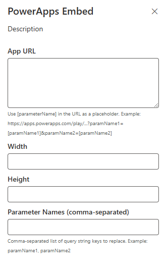

# power-apps-wp

## Summary

Short summary on functionality and used technologies.

[picture of the solution in action, if possible]

## Used SharePoint Framework Version


## Applies to

- [SharePoint Framework](https://aka.ms/spfx)
- [Microsoft 365 tenant](https://docs.microsoft.com/en-us/sharepoint/dev/spfx/set-up-your-developer-tenant)

> Get your own free development tenant by subscribing to [Microsoft 365 developer program](http://aka.ms/o365devprogram)

## Prerequisites

> Any special pre-requisites?

## Solution

| Solution    | Author(s)                                               |
| ----------- | ------------------------------------------------------- |
| folder name | Author details (name, company, twitter alias with link) |

## Version history

| Version | Date             | Comments        |
| ------- | ---------------- | --------------- |
| 1.1     | March 10, 2021   | Update comment  |
| 1.0     | January 29, 2021 | Initial release |

## Disclaimer

**THIS CODE IS PROVIDED _AS IS_ WITHOUT WARRANTY OF ANY KIND, EITHER EXPRESS OR IMPLIED, INCLUDING ANY IMPLIED WARRANTIES OF FITNESS FOR A PARTICULAR PURPOSE, MERCHANTABILITY, OR NON-INFRINGEMENT.**

---

## Minimal Path to Awesome

- Clone this repository
- Ensure that you are at the solution folder
- in the command-line run:
  - **npm install**
  - **gulp serve**

> Include any additional steps as needed.

## documentation

# 🧩 Power Apps SPFx Web Part

A SharePoint Framework (SPFx) web part for embedding Power Apps applications in modern SharePoint Online pages. Supports dynamic query string parameters and full-width layout compatibility.

---

## 📦 Features

- Embed Power Apps in modern SharePoint pages
- Use dynamic parameters in URLs (e.g., `?cmSummaryId=123`)
- Automatically resolves and replaces placeholders like `[cmSummaryId]`
- Displays a placeholder message when no app is configured
- Works in **full-width page sections**
- Customizable iframe dimensions via Web Part settings

---

## 🛠️ Property Pane Configuration

| Property        | Description                                                              |
|----------------|---------------------------------------------------------------------------|
| `App URL`       | The Power Apps app URL. Use placeholders like `[cmSummaryId]`.           |
| `Width`         | Width of the iframe (e.g., `100%`, `800`).                               |
| `Height`        | Height of the iframe (e.g., `600`).                                      |
| `Param Names`   | Comma-separated list of parameters to read from the page query string.   |

**Example URL with placeholders:**

https://apps.powerapps.com/play/appId=xxx&cmSummaryId=[cmSummaryId]


If the SharePoint page URL is:
https://site/page.aspx?cmSummaryId=456

The app URL becomes:
https://apps.powerapps.com/play/appId=xxx&cmSummaryId=456

---

## 🧠 Power Apps Setup

To enable parameter-based navigation and dynamic record loading from SharePoint, configure the following properties in your Power App:


### 🔹 `OnStart` Property

```powerapps
// Identify which parameter is passed
If(
    Value(Param("cmId")) > 0,
    Set(varParamId, Value(Param("cmId")));
    Set(varCurrentTab, varNavigationTabs.varDetails)
);
If(
    Value(Param("cmSummaryId")) > 0,
    Set(varParamId, Value(Param("cmSummaryId")));
    Set(varCurrentTab, varNavigationTabs.varIntakeSummary)
);
If(
    Value(Param("cmApprovalId")) > 0,
    Set(varParamId, Value(Param("cmApprovalId")));
    Set(varCurrentTab, varNavigationTabs.varOverview)
);

// If a valid param is found
If(
    !IsBlank(varParamId),
    Set(varSelectedItem, LookUp(cm_ComplaintDB, ID = varParamId));
    Set(varMenuSelected, 2);
    Set(varcm_ResearchRecord, LookUp(cm_ComplaintSurvey, cm_Id.Value = Text(varSelectedItem.ID)));
    Set(varcm_ApprovalTracker, LookUp(cm_ApprovalTracker, cm_Id.Value = Text(varSelectedItem.ID)));
    Set(varFormMode, "Edit");
    ViewForm(form_Complaint);
    EditForm(form_Survey);
    // Load attachments
    ClearCollect(
        colAttachment,
        Filter(cm_ComplaintLibrary, cm_Id.Value = Text(varSelectedItem.ID))
    )
,
    // No param found, start new
    NewForm(form_Complaint)
);

```
### 🔹 `StartScreen ` Property

```powerapps
If(
    Value(Param("cmId")) > 0, HomeScreen,
    Value(Param("cmSummaryId")) > 0, SummaryScreen,
    Value(Param("cmApprovalId")) > 0, OverviewScreen,
    HomeScreen
)
 ```
## 🧱 Full Width Supports

``` JSON
"supportsFullBleed": true,

```

### Example (PowerAppsWpWebPart.manifest.json):
``` JSON
{
  "id": "xxxxxxxx-xxxx-xxxx-xxxx-xxxxxxxxxxxx",
  "alias": "PowerAppsWpWebPart",
  "componentType": "WebPart",
  "version": "1.0.0",
  "manifestVersion": 2,
  "supportsFullBleed": true,
  ...
}

```
## ✅ Example Use Case

### Scenario  
You want to embed a complaint record form that loads a specific item by its ID.

---

### 🔧 Web Part Configuration

#### ▶️ For One Parameter

| **Property**   | **Value**                                              |
|----------------|--------------------------------------------------------|
| App URL        | `https://apps.powerapps.com/play/...?cmId=[cmId]`      |
| Width          | `800`                                                  |
| Height         | `600`                                                  |
| Param Names    | `cmId`                                                 |

---

#### ▶️ For Multiple Parameters

| **Property**   | **Value**                                                                                  |
|----------------|--------------------------------------------------------------------------------------------|
| App URL        | `https://apps.powerapps.com/play/...?cmId=[cmId]&cmSummaryId=[cmSummaryId]&cmApprovalId=[cmApprovalId]` |
| Width          | `800`                                                                                      |
| Height         | `600`                                                                                      |
| Param Names    | `cmId, cmSummaryId, cmApprovalId`                                                          |

---

### 🔗 SharePoint Page URL

```url
https://site/page.aspx?cmSummaryId=456

```

# Power Apps Emded Preview

## Welcome Image

This will display when a power apps Embed webpart is added to the page for the first time as a welcome screen


## Configuration Image



> Share your web part with others through Microsoft 365 Patterns and Practices program to get visibility and exposure. More details on the community, open-source projects and other activities from http://aka.ms/m365pnp.

## References

- [Getting started with SharePoint Framework](https://docs.microsoft.com/en-us/sharepoint/dev/spfx/set-up-your-developer-tenant)
- [Building for Microsoft teams](https://docs.microsoft.com/en-us/sharepoint/dev/spfx/build-for-teams-overview)
- [Use Microsoft Graph in your solution](https://docs.microsoft.com/en-us/sharepoint/dev/spfx/web-parts/get-started/using-microsoft-graph-apis)
- [Publish SharePoint Framework applications to the Marketplace](https://docs.microsoft.com/en-us/sharepoint/dev/spfx/publish-to-marketplace-overview)
- [Microsoft 365 Patterns and Practices](https://aka.ms/m365pnp) - Guidance, tooling, samples and open-source controls for your Microsoft 365 development
